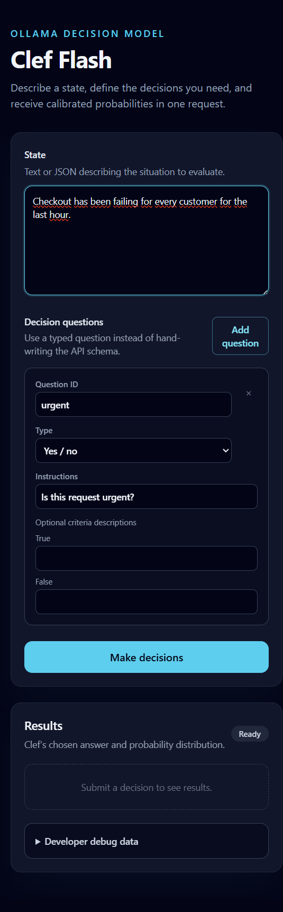

# Clef Decision UI for Ollama

Run Clef Flash with NVIDIA GPU support and a browser-based decision UI using
Docker Compose. The UI sends a state and structured questions to Ollama's
`/v1/systemone` API, not a chat endpoint.



## Getting started

Install Docker with Compose and configure the NVIDIA Container Toolkit for GPU
access. Clef Flash requires Ollama 0.35.1 or later. Then run:

```sh
docker compose up -d
```

The stack downloads `clef-flash:latest` on startup and starts the UI after the
download completes. This may take some time; check progress with:

```sh
docker compose logs -f ollama-pull
```

Open [http://localhost:8080](http://localhost:8080) when the UI is ready.

## Making a decision with Clef

1. Enter the situation in **State**, as plain text or JSON. For example:
   `Checkout has been failing for every customer for the last hour.`
2. Give the question a unique ID and instructions, such as `urgent` and
   `Is this request urgent?`.
3. Choose a question type and define its criteria:
   - **Yes / no** (`noul`): optionally describe the true and false outcomes.
   - **Choice** (`choice`): provide at least two named options, with optional
     descriptions.
   - **Score** (`score`): provide at least two level descriptions, ordered
     from lowest to highest.
4. Use **Add question** to evaluate more questions against the same state, then
   select **Make decisions**.

Results show Clef's probabilities and, for choice and score questions, the
selected answer or score and confidence. The UI also displays request timing
and token counts. Expand **Developer debug data** to inspect the generated
SystemOne request and raw Ollama response.

## Configuration and shutdown

To pull and use a different model compatible with Ollama's SystemOne API, set
`OLLAMA_MODEL` when starting the stack:

```sh
OLLAMA_MODEL="your-systemone-model" docker compose up -d
```

Stop the services with `docker compose down`. The `ollama-data` volume is
retained, so downloaded models persist across restarts.